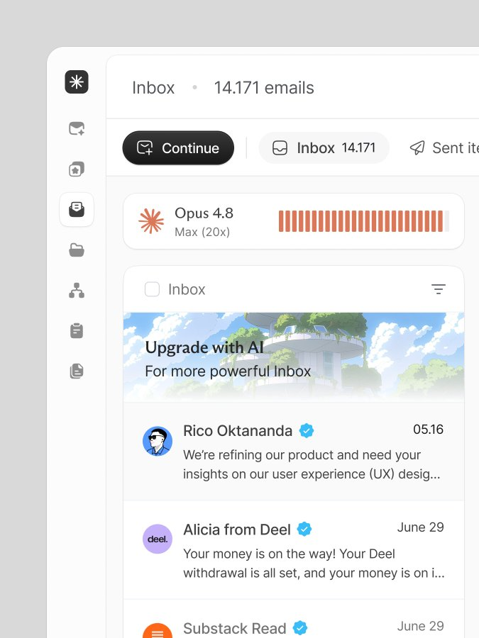

# Crooli Mail

A fast, modern email client for macOS (Windows coming later), powered by the AI you already have. Made by [Crooli](https://crooli.com).



## Why

- **Beautiful.** It has a calm, modern interface that's clearly Crooli: our own typeface, Crooli Sans, and the Crooli mark.
- **Lightning fast.** It's local-first, every view reads from an on-device cache, and search is instant.
- **AI with no setup.** Crooli uses **Claude Code** or **Codex**, whichever is already on your machine. There are no API keys and no extra subscription.
- **No accounts.** You don't sign up for anything, Crooli has no servers, and there's no tracking. Your mail goes only between your computer and your mail provider.

## What the AI does

- Summarizes long threads in one line
- Drafts replies in your voice
- **Continue** works through your inbox for you (triage, drafts, flags) and you approve its actions
- Answers questions about your email: "When does my Deel payout land?"

## Status

🚧 **Early build.** It connects to Gmail, iCloud, Yahoo, Fastmail or any IMAP mailbox with an app password, and the app shows you exactly how for each provider. Outlook needs Microsoft sign-in, which comes next. AI summaries, reply drafts and Continue run through your local Claude Code or Codex. See [PLAN.md](PLAN.md).

## Install

```bash
curl -fsSL https://mail.crooli.com/install.sh | bash
```

Website: [mail.crooli.com](https://mail.crooli.com). The installer downloads the latest release from GitHub into `/Applications`. Files fetched with curl aren't quarantined, so there's no Gatekeeper prompt.

Mail updates itself: it checks for new versions at launch and shows an **Update** button when one is ready (Settings → Updates). Updates are signed by Crooli and only install when you press the button.

## Run from source

```bash
pnpm install
```

```bash
pnpm app
```

Needs Node 20+, pnpm, Rust and Xcode Command Line Tools.

## Shortcuts

`J`/`K` move · `E` archive · `S` star · `C` compose · `⌘K` or `/` search and commands · `Esc` close

## Requirements (planned)

- macOS 13+
- [Claude Code](https://docs.claude.com/en/docs/claude-code) or [Codex CLI](https://github.com/openai/codex), installed and logged in
- A Gmail, Outlook, iCloud or any IMAP mailbox

## Stack (planned)

Tauri v2 (Rust) · React + TypeScript · Tailwind · SQLite/FTS5

## Repo layout

```
design/reference/   Source-of-truth UI mockups (must be matched pixel-for-pixel)
design/brand/       Crooli logos, Crooli Sans font, colour tokens, brand guide
src/, src-tauri/    The app (React UI, Rust backend)
web/                The website at mail.crooli.com (Vercel Root Directory: web)
PLAN.md             Product + technical plan
CLAUDE.md           Guidance for AI agents working on this repo
```

## Ownership

Crooli Mail is owned and developed by **Crooli** · [crooli.com](https://crooli.com). The Crooli name and logo are Crooli's trademarks. Crooli Sans is licensed under the SIL Open Font License (see `design/brand/fonts/OFL.txt`).
